<p align="center">
  <picture><source media="(max-width: 600px) and (prefers-color-scheme: dark)" srcset="assets/banner-m-dark.svg"><source media="(max-width: 600px)" srcset="assets/banner-m-light.svg"><source media="(prefers-color-scheme: dark)" srcset="assets/banner-dark.svg"></picture>
</p>

<p align="center">
  <picture><source media="(max-width: 600px) and (prefers-color-scheme: dark)" srcset="assets/covers-m-dark.svg"><source media="(max-width: 600px)" srcset="assets/covers-m-light.svg"><source media="(prefers-color-scheme: dark)" srcset="assets/covers-dark.svg"></picture>
</p>

<p align="center">
  <a href="nixos-homelab/"><picture><source media="(max-width: 600px) and (prefers-color-scheme: dark)" srcset="assets/talk-nixos-homelab-m-dark.svg"><source media="(max-width: 600px)" srcset="assets/talk-nixos-homelab-m-light.svg"><source media="(prefers-color-scheme: dark)" srcset="assets/talk-nixos-homelab-dark.svg"></picture></a>
</p>

<p align="center">
  <a href="minecraft-server/"><picture><source media="(max-width: 600px) and (prefers-color-scheme: dark)" srcset="assets/talk-minecraft-server-m-dark.svg"><source media="(max-width: 600px)" srcset="assets/talk-minecraft-server-m-light.svg"><source media="(prefers-color-scheme: dark)" srcset="assets/talk-minecraft-server-dark.svg"></picture></a>
</p>

<p align="center">
  <picture><source media="(max-width: 600px) and (prefers-color-scheme: dark)" srcset="assets/keys-m-dark.svg"><source media="(max-width: 600px)" srcset="assets/keys-m-light.svg"><source media="(prefers-color-scheme: dark)" srcset="assets/keys-dark.svg"></picture>
</p>

> [!TIP]
> **To open a talk**, open its folder, download `index.html` and open it in a browser. It runs offline;
> GitHub itself only shows the file as source code.

<p align="center">
  <picture><source media="(max-width: 600px) and (prefers-color-scheme: dark)" srcset="assets/style-m-dark.svg"><source media="(max-width: 600px)" srcset="assets/style-m-light.svg"><source media="(prefers-color-scheme: dark)" srcset="assets/style-dark.svg"></picture>
</p>

<details>
<summary><code>[ HOW THIS README WORKS ]</code></summary>

<br>

No screenshots of text, no third-party cards. Every image is an SVG drawn by [`build.py`](build.py) in the decks'
own style, with the text turned into outlines. The fonts are taken straight out of a deck's `index.html`. Each image
has a light and a dark version and a phone layout, and they follow your system theme.

| piece | what moves |
| --- | --- |
| **banner** | the prompt types `ls -1`, the title draws in, three made-up talk covers fan out, the marquee keeps scrolling |
| **covers** | three mock covers for talks that don't exist (yet) wipe in, one after another |
| **talk cards** | a mock of the talk's cover wipes in, the title draws, the chips and the talk's own palette pop in |
| **keys** | the keycaps pop in; every few seconds the `→` key gets pressed |
| **house style** | the specimens draw in under a marching dashed rule |
| **footer** | the prompt types `exit`, the progress bar fills, the cursor blinks |

The covers in the banner are for talks that don't exist (yet), drawn in the decks' style; the real slides are on each talk's own page. Edit `MOCK_COVERS` to change them.
The Minecraft talk breaks the house style on purpose: its card and its own page are drawn by [`minecraft.py`](minecraft.py) in that deck's pixel style.
Everything plays once on load and stays still for people who prefer reduced motion.

**Adding a talk:** put its folder next to `nixos-homelab/` with the deck as `index.html`, save its cover and a few
other slides as 960×540 (plus 640×360 `-s`) JPEGs in `assets/thumbs/`, add it to `TALKS` in `build.py`, and run:

```sh
pip install fonttools uharfbuzz brotli
python3 build.py
```

It writes this README, every talk's own README and all the images.

**Editing a deck:** open its `index.html`, press `Esc`, edit, then save with `⌘S` / `Ctrl+S`.

</details>

<p align="center">
  <picture><source media="(max-width: 600px) and (prefers-color-scheme: dark)" srcset="assets/footer-m-dark.svg"><source media="(max-width: 600px)" srcset="assets/footer-m-light.svg"><source media="(prefers-color-scheme: dark)" srcset="assets/footer-dark.svg"></picture>
</p>

<p align="center">
  <a href="https://bento.page"><picture><source media="(max-width: 600px) and (prefers-color-scheme: dark)" srcset="assets/credits-m-dark.svg"><source media="(max-width: 600px)" srcset="assets/credits-m-light.svg"><source media="(prefers-color-scheme: dark)" srcset="assets/credits-dark.svg"></picture></a>
</p>
