<a href="../"><code>❮ presentations</code></a>

  <picture><source media="(max-width: 600px) and (prefers-color-scheme: dark)" srcset="../assets/minecraft-server-hero-m-dark.svg"><source media="(max-width: 600px)" srcset="../assets/minecraft-server-hero-m-light.svg"><source media="(prefers-color-scheme: dark)" srcset="../assets/minecraft-server-hero-dark.svg"></picture>

<a href="index.html"><code>▶ index.html</code></a> &nbsp;·&nbsp; <code>14 slides</code> &nbsp;·&nbsp; <code>6 chapters</code> &nbsp;·&nbsp; <code>Dias &amp; Franck</code>

  <picture><source media="(max-width: 600px) and (prefers-color-scheme: dark)" srcset="../assets/minecraft-server-gallery-m-dark.svg"><source media="(max-width: 600px)" srcset="../assets/minecraft-server-gallery-m-light.svg"><source media="(prefers-color-scheme: dark)" srcset="../assets/minecraft-server-gallery-dark.svg"></picture>

  <picture><source media="(max-width: 600px) and (prefers-color-scheme: dark)" srcset="../assets/minecraft-server-chapters-m-dark.svg"><source media="(max-width: 600px)" srcset="../assets/minecraft-server-chapters-m-light.svg"><source media="(prefers-color-scheme: dark)" srcset="../assets/minecraft-server-chapters-dark.svg"></picture>

  <picture><source media="(max-width: 600px) and (prefers-color-scheme: dark)" srcset="../assets/minecraft-server-mouse-m-dark.svg"><source media="(max-width: 600px)" srcset="../assets/minecraft-server-mouse-m-light.svg"><source media="(prefers-color-scheme: dark)" srcset="../assets/minecraft-server-mouse-dark.svg"></picture>

> [!TIP]
> This deck also takes every key from the [main README](../README.md): arrows, `Space`, `S` for speaker view,
> `B` for a black screen, `L` for the laser pointer.

  <picture><source media="(max-width: 600px) and (prefers-color-scheme: dark)" srcset="../assets/minecraft-server-palette-m-dark.svg"><source media="(max-width: 600px)" srcset="../assets/minecraft-server-palette-m-light.svg"><source media="(prefers-color-scheme: dark)" srcset="../assets/minecraft-server-palette-dark.svg"></picture>

<code>[ BEFORE THE TALK ]</code>

 

- Scan the QR code on slide 14 once with your own phone. It opens <https://hello.errornoslash.be>.
- The speaker notes start with **[DIAS]** or **[FRANCK]**, so each of you knows when it’s your turn.
- Check the descriptions of **Old survival** and **Anarchy** on slide 9 against how you use those worlds.
- Slide 11 says players rejoin the world they left: that’s SmartRejoin’s default setting.

  <picture><source media="(max-width: 600px) and (prefers-color-scheme: dark)" srcset="../assets/minecraft-server-footer-m-dark.svg"><source media="(max-width: 600px)" srcset="../assets/minecraft-server-footer-m-light.svg"><source media="(prefers-color-scheme: dark)" srcset="../assets/minecraft-server-footer-dark.svg"></picture>

Minecraft is a trademark of Mojang Studios. This talk is a fan-made explainer, not affiliated with Mojang or Microsoft.

