<a href="../"><code>❮ presentations</code></a>

  <picture><source media="(max-width: 600px) and (prefers-color-scheme: dark)" srcset="../assets/nixos-homelab-hero-m-dark.svg"><source media="(max-width: 600px)" srcset="../assets/nixos-homelab-hero-m-light.svg"><source media="(prefers-color-scheme: dark)" srcset="../assets/nixos-homelab-hero-dark.svg"></picture>

<a href="index.html"><code>▶ index.html</code></a> &nbsp;·&nbsp; <code>22 slides</code> &nbsp;·&nbsp; <code>8 chapters</code>

  <picture><source media="(max-width: 600px) and (prefers-color-scheme: dark)" srcset="../assets/nixos-homelab-gallery-m-dark.svg"><source media="(max-width: 600px)" srcset="../assets/nixos-homelab-gallery-m-light.svg"><source media="(prefers-color-scheme: dark)" srcset="../assets/nixos-homelab-gallery-dark.svg"></picture>

  <picture><source media="(max-width: 600px) and (prefers-color-scheme: dark)" srcset="../assets/nixos-homelab-chapters-m-dark.svg"><source media="(max-width: 600px)" srcset="../assets/nixos-homelab-chapters-m-light.svg"><source media="(prefers-color-scheme: dark)" srcset="../assets/nixos-homelab-chapters-dark.svg"></picture>

  <picture><source media="(max-width: 600px) and (prefers-color-scheme: dark)" srcset="../assets/nixos-homelab-mouse-m-dark.svg"><source media="(max-width: 600px)" srcset="../assets/nixos-homelab-mouse-m-light.svg"><source media="(prefers-color-scheme: dark)" srcset="../assets/nixos-homelab-mouse-dark.svg"></picture>

> [!TIP]
> This deck also takes every key from the [main README](../README.md): arrows, `Space`, `S` for speaker view,
> `B` for a black screen, `L` for the laser pointer.

  <picture><source media="(max-width: 600px) and (prefers-color-scheme: dark)" srcset="../assets/nixos-homelab-palette-m-dark.svg"><source media="(max-width: 600px)" srcset="../assets/nixos-homelab-palette-m-light.svg"><source media="(prefers-color-scheme: dark)" srcset="../assets/nixos-homelab-palette-dark.svg"></picture>

  <picture><source media="(max-width: 600px) and (prefers-color-scheme: dark)" srcset="../assets/nixos-homelab-footer-m-dark.svg"><source media="(max-width: 600px)" srcset="../assets/nixos-homelab-footer-m-light.svg"><source media="(prefers-color-scheme: dark)" srcset="../assets/nixos-homelab-footer-dark.svg"></picture>

